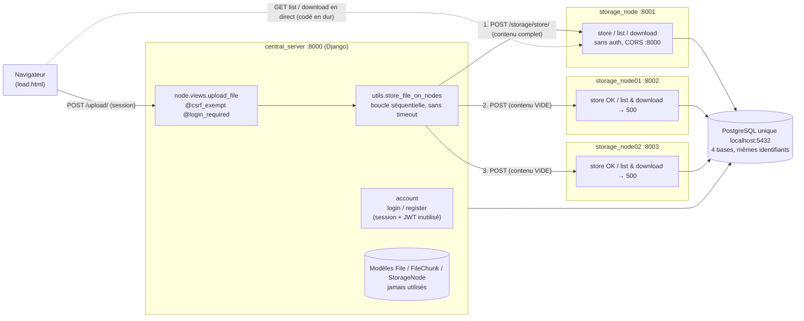

# Audit technique — Service de stockage distribué

> Revue réalisée le 17/11/2026, en vue de publier le projet sur GitHub comme élément de portfolio.
> Périmètre : `central_server/`, `storage_node/`, `storage_node01/` et `storage_node02/`. Le venv `env/` n'est examiné que pour les dépendances.
> Aucun fichier du projet n'a été modifié. Les essais ont tourné avec des réglages de substitution (SQLite jetable) placés hors du dépôt.
> *Note (20/11/2026) : les identifiants exposés cités dans ce document ont été expurgés avant publication ; ils sont considérés comme compromis.*

---

## 1. Résumé exécutif

Le projet pose une architecture **coordinateur + nœuds de stockage** en Django, avec une réplication « écrire partout » vers trois nœuds en HTTP. L'intuition est bonne : séparation métadonnées/données, modèle de *chunks* préparé, rapport par nœud des succès et des échecs.
En revanche, **la fonction principale ne marche pas de bout en bout** : les répliques 2 et 3 reçoivent des fichiers **vides**, le téléchargement **corrompt** les données, et deux nœuds sur trois plantent à la lecture. S'y ajoutent l'absence de timeout, d'authentification entre nœuds et de tests, des secrets codés en dur, ainsi qu'un dépôt non prêt à publier (venv, captures d'écran, bases).

**Note globale : 3/10.** L'architecture est lisible et démontre les bonnes intuitions d'un système distribué : 3 points pour cela. En l'état, aucune garantie de durabilité ni de cohérence n'est tenue, et aucun fichier ne peut être relu intact. Après la phase 1 de la feuille de route, le projet peut viser 6/10, et 8 à 9/10 après les phases 2 et 3.

---

## 2. Ce que j'ai exécuté et observé

| Étape | Résultat |
|---|---|
| Environnement | Python 3.13.1, Django 5.2.3, `requests`, `psycopg2-binary`, `django-cors-headers`, DRF et `djangorestframework-simplejwt` (venv `env/`). **Aucun `requirements.txt`**. |
| `manage.py check` (×4 projets) | ✅ Aucune erreur. |
| `manage.py test` | ⚠️ `Found 0 test(s)` : les fichiers `tests.py` sont vides. |
| PostgreSQL | Un serveur écoute sur `localhost:5432` et les migrations sont appliquées. Je n'ai pas écrit dans tes bases : l'essai de bout en bout a utilisé des SQLite temporaires. |
| `GET /` (central) | ✅ 200, la page d'upload s'affiche. |
| `POST /upload/` sans session | ❌ Redirection vers `/account/account/login/`, qui répond **404** (`LOGIN_URL` erroné). |
| Connexion `POST /login/` | ⚠️ 200, mais le navigateur affiche un **JSON brut** (jetons JWT) au lieu d'une redirection. |
| Upload de 18 000 octets | ⚠️ Réponse « Fichier téléversé dans 3 nœud(s) ». **En base : nœud 1 = 18 000 octets, nœuds 2 et 3 = 0 octet.** |
| Download sur le nœud 8001 | ❌ 36 000 octets reçus, contenu `72697676…` (code décimal de chaque octet) : **données corrompues**. Même comportement vérifié avec un `memoryview`, le type renvoyé par PostgreSQL. |
| List et download sur les nœuds 8002 et 8003 | ❌ **500** `AttributeError: 'StoredFile' object has no attribute 'size'` (et `.file`). |
| Upload de 2 fichiers en même temps | ⚠️ Seul le **dernier** est stocké. |
| `POST` direct sur un nœud, sans authentification | ❌ Accepté (200) : n'importe qui peut écrire, lister et lire. |
| `GET /download/1/` (central) | ❌ 500 (route mal câblée). |
| Panne d'un nœud et nœud qui ne répond pas | ❌ Le central reste **bloqué indéfiniment** sur le nœud lent : le client abandonne au bout de 30 s, faute de timeout. |
| Venv | ⚠️ Contient `rest_framework_simplejwt 0.0.2`, un paquet de démonstration d'attaque par *dependency confusion*. Il a probablement été installé via `pipreqs`. Il est inoffensif, mais il prouve que les dépendances n'ont pas été relues. |

---

## 3. Architecture reconstituée

### 3.1 Rôles

- **`central_server`** (port 8000, hypothèse) joue le rôle de coordinateur et de frontal web. Il gère l'authentification des utilisateurs (sessions Django et émission de JWT inutilisés) et la page d'upload. Il relaie chaque upload vers **tous** les nœuds de `settings.STORAGE_NODES`.
- **`storage_node`, `storage_node01`, `storage_node02`** (ports 8001, 8002 et 8003, hypothèse fondée sur l'ordre de `STORAGE_NODES` et sur le fait que seul `storage_node` active CORS) sont trois **copies divergentes** du même code. Chacune stocke les fichiers **dans PostgreSQL** (`BinaryField`) et expose `store`, `list` et `download` sans authentification.
- **PostgreSQL** : un **seul serveur** (`localhost:5432`) héberge les 4 bases (`distributed_storage`, `storage_node`, `storage_node01`, `storage_node02`). Les « nœuds » partagent donc le même domaine de panne.

Il s'agit d'un modèle **maître/esclaves** (coordinateur + workers), pas d'un modèle pair-à-pair.

### 3.2 Protocole

HTTP/1.1 synchrone, `multipart/form-data` pour les écritures et JSON pour les réponses. Les connexions ne sont ni authentifiées ni chiffrées.

### 3.3 Chemin d'une écriture

1. Le navigateur envoie `POST /upload/` au central (session requise, CSRF désactivé).
2. `store_file_on_nodes` boucle **séquentiellement** sur les 3 nœuds et fait `requests.post(..., files={"file": file})` **sans timeout**.
3. Le même objet fichier est réutilisé : il est lu jusqu'à la fin pour le nœud 1, puis envoyé **vide** aux nœuds 2 et 3.
4. Le central répond 200 dès qu'**au moins un** nœud a répondu 200. **Aucune métadonnée n'est enregistrée** : les modèles `File`, `FileChunk` et `StorageNode` ne sont jamais utilisés.

### 3.4 Chemin d'une lecture

Le navigateur appelle **directement** `http://localhost:8001/storage/list/` puis `/storage/download/<id>/` (URL codée en dur dans le JavaScript). Le central n'intervient pas. Il n'y a pas de bascule vers une autre réplique, et l'`id` est l'auto-incrément **local** du nœud 1.

### 3.5 Répartition des données

Il n'y a **aucun partitionnement** : réplication complète, avec RF = N = 3 en intention. Le modèle `FileChunk` (avec `unique_together(file, chunk_index)`) laisse penser qu'un découpage en blocs était prévu (hypothèse), mais il n'est pas implémenté.

---

## 4. Ce qui est bien fait

- **Séparation claire des rôles** entre le coordinateur et les nœuds de stockage, chacun avec sa propre base. C'est la bonne forme pour faire évoluer le projet vers un modèle de type GFS/HDFS.
- **Bonne modélisation des métadonnées**, même si elle n'est pas branchée : `StorageNode` (capacité, espace utilisé, `is_active`), `File` (taille, `checksum`, propriétaire) et `FileChunk` avec `unique_together` (`central_server/node/models.py:4-36`). Ce sont exactement les concepts d'un vrai système de fichiers distribué.
- **Isolation des pannes par nœud** à l'écriture : chaque appel est dans son propre `try/except requests.RequestException`, et la réponse détaille `successful_nodes` et `failed_nodes` (`central_server/node/utils.py:16-37`). Un nœud qui refuse la connexion ne fait pas échouer toute l'opération.
- **Journalisation utile** de chaque tentative par nœud (`utils.py:18-30`).
- **Protection contre le path traversal** : le nom vient du parseur multipart de Django, qui supprime les composants de chemin, et le contenu est stocké en base. J'ai vérifié qu'un nom `../../evil` est neutralisé.
- **L'ORM est utilisé partout** : pas d'injection SQL possible.
- **Comptes utilisateurs** : `AuthenticationForm`, `UserCreationForm` et les validateurs de mot de passe de Django. Le CSRF est actif sur les formulaires de connexion et d'inscription.
- **Migrations versionnées**, et les quatre projets passent `manage.py check` sans erreur.
- Le front utilise `textContent` pour l'aperçu des fichiers sélectionnés (`load.html:120`), ce qui est sûr.

---

## 5. Tableau des problèmes

Gravité : **Critique** (perte, corruption de données ou faille majeure) / **Haute** / **Moyenne** / **Basse**. Effort : **S** (< 1 h), **M** (une demi-journée), **L** (plus d'un jour).

| ID | Axe | Gravité | Description | Emplacement | Correctif proposé | Effort |
|---|---|---|---|---|---|---|
| P01 | 1 – Robustesse | **Critique** | Le même `UploadedFile` est relu à chaque itération. Après le 1er nœud, le curseur est en fin de fichier : les nœuds 2 et 3 stockent **0 octet** et répondent 200 (vérifié). La réplication est fictive. | `central_server/node/utils.py:16-19` | Lire le contenu une seule fois (`data = file.read()`) ou faire `file.seek(0)` avant chaque envoi. Envoyer `(file.name, data, content_type)` et un checksum SHA-256 que le nœud vérifie. | S |
| P02 | 1 – Robustesse | **Critique** | `FileResponse(bytes)` itère sur les octets et renvoie leur valeur décimale : `"AB"` devient `"6566"`. **Tout téléchargement est corrompu** (vérifié avec `bytes` et `memoryview`). | `storage_node/storage/views.py:36` | `HttpResponse(bytes(file.content), content_type=...)`, ou `FileResponse(io.BytesIO(...))`. Ajouter un test aller-retour par checksum. | S |
| P03 | 5 – Qualité | **Critique** | Les nœuds 01 et 02 lisent `file.size` et `file.file`, des champs qui n'existent pas sur `StoredFile` : **500** sur `list` et `download` (vérifié). | `storage_node01/storage/views.py:56,62` ; `storage_node02/storage/views.py:29,35` | Fusionner les 3 copies en **un seul projet `storage_node`** paramétré par variables d'environnement (`NODE_ID`, `PORT`, `DATABASE_URL`). Ajouter un champ `size` (ou le calculer). | M |
| P04 | 4 – Sécurité | **Critique** | Les nœuds n'ont **aucune authentification** : n'importe qui peut écrire (`csrf_exempt`), lister **tous les fichiers de tous les utilisateurs** et les télécharger. Aucune notion de propriétaire côté nœud. | `storage_node/storage/views.py:7-38` | Les nœuds ne sont accessibles **que par le central**, avec un jeton partagé (en-tête HMAC ou `Authorization: Bearer` venant de l'environnement) ou du mTLS. Les lectures client passent par le central, qui vérifie `File.owner`. | M |
| P05 | 4 – Sécurité | **Critique** (pré-publication) | Secrets codés en dur : 4 `SECRET_KEY` et les identifiants PostgreSQL (valeurs expurgées). `DEBUG = True`. | `central_server/central_server/settings.py:24,27,100-109` ; `storage_node*/…/settings.py:24,27,98-107` | Passer par des variables d'environnement (`django-environ` ou `os.environ`), fournir un `.env.example` et **régénérer les clés** avant le premier commit (le dossier n'est pas encore un dépôt git, il n'y a donc pas d'historique à purger). | S |
| P06 | 1 – Robustesse | **Haute** | Aucun timeout sur `requests.post` : un nœud lent ou en partition « silencieuse » **bloque le worker du central indéfiniment** (vérifié : plus de 30 s, puis abandon côté client). Les appels sont séquentiels, donc les latences s'additionnent. | `central_server/node/utils.py:19` | `timeout=(connect, read)` configurables. Envoi **en parallèle** (`ThreadPoolExecutor` ou `httpx` asynchrone). Retries bornés avec backoff, uniquement pour les opérations idempotentes. | S |
| P07 | 2 – Cohérence | **Haute** | Le central renvoie un succès dès **1** nœud OK (W = 1), sans jamais réparer les répliques manquantes ; elles divergent pour toujours. Il n'y a ni version, ni identifiant global (les `id` sont des auto-incréments locaux qui se décalent dès qu'un upload échoue partiellement). | `central_server/node/utils.py:32-39` ; `storage_node/storage/models.py:3-6` | Identifiant global (UUID ou hash de contenu) choisi par le central. Quorum W = ⌊N/2⌋+1, et échec explicite sinon. Enregistrer les répliques dans les métadonnées. Tâche de re-réplication (voir la phase 3). | M |
| P08 | 3 – Échelle | **Haute** | Les lectures vont **uniquement vers le nœud 8001**, codé en dur dans le JavaScript. C'est un point de défaillance unique : si 8001 tombe, plus aucune lecture n'est possible, alors que les répliques existent. | `central_server/node/templates/node/load.html:228,272` | Endpoint `GET /files/` et `GET /files/<uuid>/` sur le central, qui consulte les métadonnées et essaie les répliques dans l'ordre, avec bascule. | M |
| P09 | 2 – Cohérence | **Haute** | Les modèles de métadonnées `File`, `FileChunk` et `StorageNode` ne sont **jamais écrits ni lus**. Le central ne sait pas quels fichiers existent, où, ni à qui. `checksum` n'est jamais calculé. | `central_server/node/models.py:4-36` | Les brancher : créer `File` (propriétaire, taille, SHA-256) puis une table `Replica(file, node, status)` dans une transaction après le quorum. | M |
| P10 | 4 – Sécurité | **Haute** | **XSS stockée** : `file.name` est injecté via `innerHTML`, y compris dans un `onclick`. Combiné à P04, un attaquant anonyme peut déposer un fichier nommé `.txt` qui s'exécute dans la session de chaque utilisateur. | `central_server/node/templates/node/load.html:252-256` | Construire le DOM avec `textContent` et `addEventListener`, sans interpoler de HTML. Ajouter une CSP. | S |
| P11 | 1 – Robustesse | **Haute** | Le fichier est chargé **entièrement en mémoire** (`read()`) côté nœud et stocké en `bytea` PostgreSQL, sans limite de taille. Un gros fichier fait monter la RAM et gonfle la base. | `storage_node/storage/views.py:15` ; `storage_node/storage/models.py:5` | Stocker sur disque, dans un répertoire du nœud, sous un nom = hash (sans nom fourni par l'utilisateur) et en streaming. Fixer `DATA_UPLOAD_MAX_MEMORY_SIZE` et une taille maximale. À terme, découper en *chunks*. | M |
| P12 | 1 – Robustesse | **Haute** | Aucune détection de panne : l'endpoint `health` est commenté et `StorageNode.is_active` n'est pas utilisé. Le central écrit sans savoir quels nœuds sont vivants. | `storage_node/storage/urls.py:8` ; `central_server/node/models.py:10` | `GET /health/` sur chaque nœud, heartbeats périodiques vers le central et état `alive/suspect/dead` (voir la phase 3). | M |
| P13 | 7 – Publication | **Haute** | Le dossier contient `env/` (≈ 7 000 fichiers), des `__pycache__/*.pyc`, des `db.sqlite3` vides, des `object.png` et **deux captures d'écran personnelles** dans `storage_node02/media/` (je ne les ai pas ouvertes ; vérifie leur contenu). Il n'y a ni `.gitignore`, ni README, ni licence. | racine ; `storage_node02/media/` ; `storage_node*/object.png` | `.gitignore` Python/Django, suppression des artefacts, README et LICENSE (MIT). | S |
| P14 | 7 – Publication | **Haute** | Il n'y a pas de `requirements.txt`, et le venv contient le paquet piège `rest_framework_simplejwt 0.0.2`, signe d'une génération par `pipreqs`. Le projet n'est pas reproductible. | `env/Lib/site-packages/` | `requirements.txt` (ou `pyproject.toml`) écrit à la main avec des versions figées. Recréer le venv sans le paquet piège. | S |
| P15 | 5 – Qualité | **Moyenne** | Routage cassé : `node.urls` est inclus deux fois, et `download/<int:file_id>/` inclut tout `node.urls`, ce qui appelle `upload_page(file_id=…)` et donne un **500**. `LOGIN_URL` pointe vers `/account/account/login/`, qui répond **404**. | `central_server/central_server/urls.py:23-25` ; `settings.py:65` | Un seul `include` par application, préfixe `account/`, et `LOGIN_URL = "account:login"`. | S |
| P16 | 4 – Sécurité | **Moyenne** | `upload_file` est `@csrf_exempt` alors que l'authentification se fait par cookie de session. C'est inutile puisque le front envoie déjà `X-CSRFToken`. | `central_server/node/views.py:10` | Retirer `@csrf_exempt`. | S |
| P17 | 4 – Sécurité | **Moyenne** | Des JWT sont émis à la connexion mais **jamais vérifiés** nulle part (le middleware est commenté). Le navigateur affiche du JSON au lieu de rediriger. Deux mécanismes d'authentification coexistent sans cohérence. | `central_server/account/views.py:16-20` ; `storage_node/storage_node/settings.py:60` | Choisir : session pour l'interface web, plus éventuellement une API à jeton documentée. Rediriger après connexion. | S |
| P18 | 4 – Sécurité | **Moyenne** | Le trafic entre le client, le central et les nœuds passe en HTTP clair. `ALLOWED_HOSTS = []` et `runserver` sont utilisés comme serveur. | `settings.py:29` (×4) | TLS au niveau d'un reverse proxy (Caddy ou Traefik) dans docker-compose, `gunicorn` en production. Le documenter. | M |
| P19 | 5 – Qualité | **Moyenne** | `upload_file` ne traite que `request.FILES['file']`, alors que le front autorise `multiple` : les autres fichiers sont **ignorés en silence** (vérifié). | `central_server/node/views.py:15` ; `load.html:57,136-138` | `request.FILES.getlist('file')` et un résultat par fichier, ou retirer `multiple`. | S |
| P20 | 5 – Qualité | **Moyenne** | Le message d'exception est renvoyé au client (`str(e)`), et une `Exception` générique est levée. | `central_server/node/views.py:19-20` ; `utils.py:39` | Exception métier (`ReplicationError`), message générique côté client, détail dans les logs. | S |
| P21 | 3 – Échelle | **Moyenne** | La topologie est codée en dur (`localhost:8001-8003`). Ajouter un nœud oblige à copier un projet Django entier et à modifier le code. | `central_server/central_server/settings.py:59-63` | Liste des nœuds fournie par l'environnement, puis enregistrement dynamique (le nœud s'annonce au central). | M |
| P22 | 1 – Robustesse | **Moyenne** | Les 4 bases sont sur **le même serveur PostgreSQL** : les nœuds ne sont pas des domaines de panne indépendants. | `settings.py:100-109` (×4) | Dans docker-compose, une base (ou un volume disque) par nœud. Documenter la topologie. | S |
| P23 | 5 – Qualité | **Basse** | Code mort et commentaires : anciennes versions de `login_view` et de `store_file`, et `health_check` commenté. | `account/views.py:24-36` ; `node/utils.py:41-81` ; `storage_node01/storage/views.py:1-27` | Supprimer (git garde l'historique). | S |
| P24 | 5 – Qualité | **Basse** | Imports inutilisés : `hashlib`, `requests`, `get_object_or_404`, `StreamingHttpResponse`, `random`, `os`, `default_storage`, `login_required`… | `node/views.py:1-7` ; `node/utils.py:1-6` ; `storage_node/storage/views.py:5` | `ruff check --fix`. | S |
| P25 | 5 – Qualité | **Basse** | `account/views.py` importe `central_server.settings` directement au lieu de `django.conf.settings`. | `central_server/account/views.py:5` | `from django.conf import settings`. | S |
| P26 | 5 – Qualité | **Basse** | La barre de progression mesure le téléchargement de la **réponse**, pas l'envoi : elle est inutile. | `load.html:151-179` | `XMLHttpRequest.upload.onprogress`, ou la supprimer. | S |
| P27 | 6 – Tests | **Haute** | **Zéro test.** Aucun scénario de panne, d'aller-retour d'intégrité ni de concurrence. Les bugs P01 à P03 auraient été détectés par un seul test. | `*/tests.py` | Voir la phase 2 : `pytest-django` et des tests d'intégration docker-compose avec injection de pannes. | M |

---

## 6. Analyse par axe (synthèse)

### 6.1 Correction et robustesse distribuée
- **Nœud en panne** (connexion refusée) : l'écriture réussit partiellement et la réplique manquante ne sera jamais rattrapée. Si c'est le nœud 8001, **plus aucune lecture n'est possible**.
- **Nœud lent ou partition silencieuse** : le central est bloqué indéfiniment (P06).
- **Redémarrage d'un nœud** : sans conséquence immédiate (données en base), mais il n'existe aucun mécanisme de resynchronisation.
- **Concurrence** : `runserver` est multi-thread et les écritures sont indépendantes, donc il n'y a pas de course dangereuse aujourd'hui. Mais un upload n'est **ni atomique ni idempotent** entre les nœuds : un retry crée des doublons, et deux fichiers de même nom coexistent sans relation.
- **Perte et corruption** : avérées (P01, P02).

### 6.2 Modèle de cohérence et réplication
- **Garantie réellement offerte : aucune.** Le système fonctionne en « meilleur effort » : RF = 3 en intention, W = 1 et R = 1 sur un nœud fixe, sans versionnement, réparation à la lecture, anti-entropie ni gestion des conflits. Le système n'est même pas cohérent à terme, puisque rien ne fait converger les répliques.

### 6.3 Répartition et passage à l'échelle
- Pas de partitionnement : chaque nœud stocke tout, donc la capacité totale est celle du plus petit nœud.
- Points de défaillance uniques : le central, le nœud 8001 (lectures) et l'unique serveur PostgreSQL.
- Goulots d'étranglement : le central relaie tous les octets, séquentiellement et entièrement en mémoire ; stockage en `bytea`.
- Ajout ou retrait de nœud : manuel, avec modification du code et sans rééquilibrage.

### 6.4 Sécurité
Points critiques : nœuds ouverts (P04), secrets (P05) et XSS stockée (P10). Pas de désérialisation dangereuse (ni `pickle` ni `yaml.load`). Le path traversal est neutralisé par Django et par le stockage en base ; il redeviendra un sujet si les fichiers passent sur disque (utiliser des noms dérivés du hash).

### 6.5 Qualité du code
Le code est lisible et court, mais il est **dupliqué trois fois** et les copies divergent (P03). Il contient du code mort, des imports inutilisés, de la configuration codée en dur et une gestion d'erreurs trop générique.

### 6.6 Tests
Aucun test (voir P27).

### 6.7 Prêt pour GitHub
Pas encore (P05, P13, P14). Bonne nouvelle : le dossier **n'est pas encore un dépôt git**. On peut donc partir proprement, sans réécrire d'historique.

---

## 7. Feuille de route

### Phase 1 — Corrections indispensables avant publication (≈ 1 à 2 jours)
1. **Hygiène du dépôt** : `.gitignore` (venv, `__pycache__`, `*.sqlite3`, `media/`, `.env`, IDE), suppression des artefacts et des captures d'écran, `requirements.txt` figé et propre, `LICENSE` MIT (P13, P14).
2. **Secrets et configuration par l'environnement** : `.env.example`, nouvelles `SECRET_KEY`, `DEBUG` et `ALLOWED_HOSTS` configurables, liste des nœuds par variable (P05, P21).
3. **Un seul code de nœud** : fusion de `storage_node*` en un projet paramétré (P03).
4. **Rendre la fonction de base correcte** : lecture unique du fichier et checksum (P01), téléchargement intact (P02), timeouts et envoi parallèle (P06), routes et `LOGIN_URL` (P15), upload multiple (P19).
5. **Sécurité minimale** : jeton partagé entre le central et les nœuds (P04), lectures via le central avec contrôle du propriétaire (P08), correction de la XSS (P10), retrait de `csrf_exempt` (P16), choix d'un seul mécanisme d'authentification (P17).
6. **Métadonnées branchées** : `File` et `Replica` écrits au moment de l'upload (P09).
7. Nettoyage : code mort et imports (P23 à P25).

### Phase 2 — Mise à niveau « portfolio » (≈ 3 à 5 jours)
- **Docker** : un `Dockerfile` pour le central, un pour le nœud, et `docker-compose.yml` avec PostgreSQL pour les métadonnées et N nœuds avec chacun son volume. Le démarrage tient en une commande, `docker compose up --scale node=5` ou via des services nommés, avec un `Makefile` (`make up`, `make demo`, `make test`).
- **Tests automatisés** :
  - unitaires (`pytest-django`) : aller-retour avec vérification du checksum, quorum atteint ou non, comportement face aux timeouts (avec `responses` ou `respx`) ;
  - intégration (docker-compose) : on arrête un nœud avec `docker stop` pendant l'écriture puis on relit ; on rend un nœud lent (`tc netem` ou Toxiproxy) ;
  - concurrence : N uploads simultanés, pour vérifier l'absence de doublons et de corruption.
- **CI GitHub Actions** : `ruff` et `mypy` (optionnel), tests unitaires, puis un *smoke test* docker-compose avec upload, panne d'un nœud et lecture. Badge dans le README.
- **API documentée** : `drf-spectacular` (OpenAPI/Swagger) ou un tableau des endpoints.
- **README professionnel** avec schéma Mermaid, GIF ou asciinema de démo, et un script `demo.sh` qui uploade, tue un nœud et relit.

### Phase 3 — Fonctionnalités distribuées qui impressionnent

| Fonctionnalité | Intérêt (ce qu'elle démontre) | Difficulté |
|---|---|---|
| **Heartbeats et détecteur de pannes** (états alive/suspect/dead, éventuellement *phi accrual*) | Comprendre l'incertitude des pannes en réseau asynchrone, les timeouts adaptatifs et les faux positifs. | ★★☆ |
| **Réplication avec quorum** (N = 3, W = 2, R = 2, W + R > N) et versionnement (LWW horodaté ou horloges vectorielles) | Le cœur des systèmes de type Dynamo et Cassandra : compromis cohérence/disponibilité (CAP, PACELC). | ★★★ |
| **Re-réplication automatique** après une panne (le central recrée les répliques manquantes à partir des métadonnées) | La durabilité concrète, comme dans HDFS ou GFS. | ★★☆ |
| **Découpage en chunks adressés par leur contenu** (SHA-256), avec déduplication et vérification d'intégrité | Stockage objet moderne (Git, IPFS, S3 multipart) et intégrité de bout en bout. | ★★☆ |
| **Hachage cohérent avec nœuds virtuels** pour placer les chunks | Répartition équilibrée et mouvement minimal lors d'un ajout ou d'un retrait de nœud. Très apprécié en entretien. | ★★☆ |
| **Rééquilibrage automatique** à l'arrivée ou au départ d'un nœud (migration en arrière-plan, débit limité) | Opérations sur un cluster vivant, sans interruption de service. | ★★★ |
| **Anti-entropie par arbres de Merkle** | Faire converger les répliques efficacement (Cassandra, DynamoDB). | ★★★ |
| **Read-repair** | Cohérence à terme opportuniste, simple à montrer en démo. | ★☆☆ |
| **Observabilité** : `/metrics` Prometheus (latence par nœud, répliques manquantes, octets stockés), tableau de bord Grafana, logs JSON avec identifiant de corrélation | Montre un état d'esprit « production » et rend la démo visuelle. | ★★☆ |
| **Tests de chaos** (Toxiproxy et un script qui tue des nœuds au hasard pendant une charge) | Prouve les garanties au lieu de les affirmer. Excellent pour le README. | ★★☆ |
| *(Option)* Coordinateur hautement disponible : métadonnées dans etcd, ou élection de leader Raft simplifiée | Supprime le dernier point de défaillance unique. Projet ambitieux. | ★★★★ |

Ordre conseillé pour un effet maximal en temps limité : heartbeats, puis quorum, puis re-réplication, puis observabilité, puis hachage cohérent avec rééquilibrage.

---

## 8. Proposition de plan de README

1. **Titre et accroche** : « Stockage d'objets distribué avec réplication par quorum, détection de pannes et auto-réparation », avec les badges CI, licence et Python.
2. **Démo** : GIF de 30 s (upload, `docker stop node2`, lecture réussie, re-réplication).
3. **Pourquoi ce projet** : contexte académique (examen de systèmes distribués) et ce qui a été ajouté ensuite.
4. **Architecture** : schéma Mermaid, rôles des composants, chemins d'écriture et de lecture.
5. **Garanties** : modèle de cohérence (N, W, R), tolérance aux pannes (« survit à la perte de ⌊(N−1)/2⌋ nœuds »), limites assumées.
6. **Démarrage rapide** : `git clone`, `cp .env.example .env`, `docker compose up`, puis l'URL de l'interface.
7. **API** : tableau des endpoints et lien Swagger.
8. **Tests** : comment lancer les tests unitaires, d'intégration et de chaos.
9. **Observabilité** : capture du tableau de bord Grafana.
10. **Choix de conception et compromis** : pourquoi un coordinateur central, pourquoi ce quorum, alternatives envisagées.
11. **Feuille de route et limites connues.**
12. **Licence et auteur.**

## 9. Points forts à mettre en avant (CV / LinkedIn)

À formuler une fois les phases correspondantes réalisées ; ne revendique que ce qui est implémenté et testé.

1. « Conçu un **service de stockage distribué** (Python/Django, Docker) avec **réplication par quorum (N = 3, W = 2, R = 2)** et intégrité de bout en bout par **SHA-256**. »
2. « Implémenté **détection de pannes par heartbeats** et **re-réplication automatique** : le cluster reste disponible et se répare après la perte d'un nœud, ce que démontrent des **tests de chaos** automatisés. »
3. « Placement des données par **hachage cohérent avec nœuds virtuels**, et **rééquilibrage** en ligne à l'ajout ou au retrait de nœuds. »
4. « **Observabilité** : métriques Prometheus et tableau de bord Grafana (latence par nœud, répliques manquantes). »
5. « **Pipeline CI GitHub Actions** : lint, tests unitaires et tests d'intégration multi-nœuds sous docker-compose avec injection de pannes. »

---

## 10. Hypothèses formulées

- Correspondance des ports : `storage_node` → 8001, `storage_node01` → 8002, `storage_node02` → 8003. Le code ne la définit nulle part ; je l'ai déduite de `STORAGE_NODES` et de la configuration CORS.
- Le modèle `FileChunk` traduit une intention de découpage en blocs qui n'a pas été réalisée faute de temps.
- Les JWT et le middleware commenté correspondent à une tentative d'authentification entre nœuds qui a été abandonnée.
- Les captures d'écran de `storage_node02/media/` sont des restes de tests manuels d'upload, issus d'une ancienne version qui stockait sur disque.
