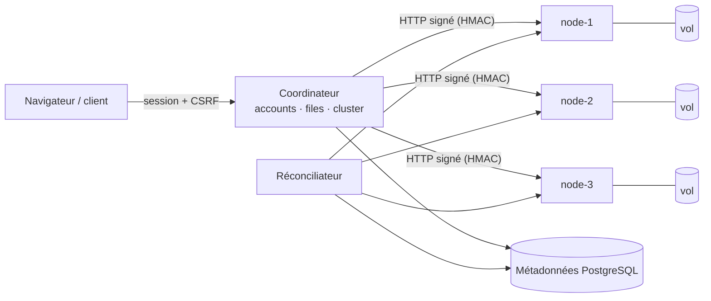

# NodeMesh — stockage d'objets répliqué, à lectures vérifiées et auto-réparation

[English](README.md) | **Français**

NodeMesh stocke des fichiers sur plusieurs nœuds de stockage indépendants. Un
coordinateur Django place **trois copies** de chaque objet, ne confirme un
téléversement qu'une fois qu'un **quorum d'écriture** l'a stocké durablement et
en a vérifié l'empreinte, ne sert un téléchargement qu'après une
**vérification SHA-256 de bout en bout** (en se rabattant sur une autre réplique
si l'une est indisponible ou corrompue), et exécute un **réconciliateur** qui
détecte les nœuds défaillants et restaure les copies manquantes ou endommagées.

> **Origine.** Ce projet est né d'un examen universitaire de systèmes
> distribués : quatre projets Django copiés les uns des autres, qui répliquaient
> les téléversements sur trois nœuds. Un audit ultérieur (conservé dans
> [`AUDIT.md`](AUDIT.md), en français) a montré que les répliques 2 et 3
> recevaient des fichiers vides, que chaque téléchargement était corrompu, que
> les nœuds n'étaient pas authentifiés et qu'aucune requête n'avait de délai
> d'expiration. Le projet a ensuite été entièrement reconstruit. L'idée à deux
> niveaux (coordinateur + nœuds de stockage) a été conservée ; tout le reste est
> nouveau, testé et documenté ci-dessous.

## Fonctionnalités

Chaque élément ci-dessous est implémenté et couvert par des tests automatisés.

- **Deux projets Django indépendants.** Un coordinateur ; une seule base de code
  pour les nœuds de stockage, exécutée en N instances (chacune avec son
  identifiant, ses clés et son volume).
- **Écritures durables sur les nœuds.** Chaque écriture est reçue en flux et
  vérifiée par SHA-256, synchronisée sur disque (`fsync`), puis publiée par un
  renommage atomique de répertoire. Un objet partiel n'est jamais visible.
- **Réplication par quorum.** RF = 3 et W = 2 par défaut. Les transferts
  s'exécutent en parallèle avec des délais d'expiration bornés. Les fichiers
  sous-répliqués sont signalés, jamais masqués. Sous le quorum, le téléversement
  échoue explicitement (503).
- **Aperçus sécurisés.** Images, PDF et texte s'affichent directement, après la
  même lecture vérifiée que les téléchargements. Le type est déterminé à partir
  des octets, aucun script n'est jamais interprété, et chaque requête est
  autorisée.
- **Lectures vérifiées avec repli.** Les répliques corrompues ou manquantes sont
  détectées, enregistrées et ignorées. Un client ne reçoit jamais d'octets non
  vérifiés.
- **Détection de pannes.** L'état d'un nœud passe de `healthy` à `unreachable`
  puis à `suspect`. Un seul dépassement de délai ne constitue pas un verdict.
- **Réconciliation.** Elle couvre :
  - la reprise après un arrêt brutal pendant un téléversement ;
  - le nettoyage (garbage collection) des fichiers en échec et supprimés ;
  - la vérification périodique des copies (scrubbing) ;
  - la re-réplication ;
  - le nettoyage des objets orphelins et l'adoption des acquittements perdus.
- **Sécurité.**
  - Utilisateurs : autorisation par utilisateur (les fichiers d'autrui renvoient
    404), authentification par session avec protection CSRF.
  - Trafic interne : clés HMAC propres à chaque nœud avec rotation, protection
    contre le rejeu et liaison à l'empreinte du corps de requête.
  - Navigateur : CSP stricte, aucun point d'injection HTML dans l'interface,
    téléversements en corps brut jamais analysés avant l'authentification.
  - Configuration : aucun secret dans le dépôt.
- **Exploitation.**
  - Une interface `make` unique pour le développement local et pour le cluster
    Docker : construction, migrations explicites, démarrage, état, inspection du
    stockage, journaux, réparation.
  - Images Docker (utilisateur non root, aucun port publié par les nœuds,
    système de fichiers racine en lecture seule pour les nœuds), chacune
    construite une seule fois.
  - Des contrôles de santé qui ont un sens : base de données joignable, volume
    du nœud accessible en écriture, cycles du réconciliateur qui aboutissent.
  - Garde-fous : aucune migration automatique d'une base partagée, aucun
    réenregistrement silencieux de nœud, aucune suppression massive par le
    nettoyage des orphelins.
  - Journaux JSON avec rotation bornée.
  - CI : lint, tests sur PostgreSQL 17 et test de panne de bout en bout sous Docker.

## Architecture



Détails (en anglais) : [architecture](docs/architecture.md) · [cohérence et sémantique des pannes](docs/consistency.md) ·
[API](docs/api.md) · [sécurité](docs/security.md) · [exploitation](docs/operations.md) · [tests](docs/testing.md)

## Garanties (RF = 3, W = 2)

| | Garanti |
|---|---|
| Téléversement `201` | ≥ 2 nœuds ont synchronisé sur disque des octets dont ils ont vérifié le SHA-256 ; `under_replicated` indique si les 3 l'ont fait |
| Téléversement `503` | Le fichier n'est pas disponible ; les copies partielles sont nettoyées ; la clé d'idempotence est libérée |
| Téléchargement `200` | Taille et SHA-256 identiques aux valeurs enregistrées lors du téléversement |
| Un nœud en panne | Les téléversements réussissent (2/3, réparés ensuite) ; tous les fichiers existants restent lisibles |
| Nouvelles tentatives | Une même `Idempotency-Key` ne crée jamais de second fichier |

**Non garanti :**
- la disponibilité du coordinateur et de PostgreSQL (points de défaillance uniques) ;
- l'indépendance de nœuds hébergés sur une même machine ;
- une réparation immédiate (elle a lieu à chaque cycle du réconciliateur).

Voir [consistency.md](docs/consistency.md#what-is-not-guaranteed).

## Composants

| Service | Rôle |
|---|---|
| **Coordinateur** | Interface web et API : utilisateurs, autorisation, métadonnées, placement, écritures par quorum, lectures vérifiées |
| **Réconciliateur** | Boucle de fond (même code que le coordinateur) : sondes de santé, reprise après arrêt brutal, vérification périodique, re-réplication, nettoyage |
| **Nœud de stockage** | Une base de code, N instances : stocke des objets immuables sur son propre volume ; API privée authentifiée par HMAC |
| **PostgreSQL** | Toutes les métadonnées (utilisateurs, fichiers, répliques, registre des nœuds) ; l'unique source de vérité |

## Démarrage

`make help` liste toutes les commandes. Deux modes de travail sont pris en
charge, chacun documenté pas à pas (en anglais).

**Développement local** : environnement virtuel Python, sans Docker, avec
n'importe quel PostgreSQL ([docs/development.md](docs/development.md)) :

```bash
make venv && make dev-env        # puis renseigner POSTGRES_PASSWORD dans .env
make dev-migrate                 # après `make dev-migrate-plan`
make dev-nodes                   # terminal 1 : 3 nœuds de stockage issus d'une seule base de code
make dev-register && make dev-run   # terminal 2 : http://127.0.0.1:8000
```

**Cluster Docker** : hôte Linux, conteneur PostgreSQL existant
([docs/deployment.md](docs/deployment.md)) :

```bash
make cluster-env                 # puis renseigner les valeurs PostgreSQL dans .env.cluster
make cluster-config cluster-build
make cluster-migrate-plan cluster-migrate
make cluster-up                  # attend que chaque service soit opérationnel
```

**Essai isolé** : une pile Docker jetable, avec son propre PostgreSQL, qui peut
fonctionner à côté d'un cluster réel (hôte Linux avec Docker ; `make cluster-env`
uniquement si `.env.cluster` n'existe pas encore) :

```bash
make cluster-env cluster-test-up cluster-test-demo cluster-test-down
```

## Documentation

La documentation détaillée est rédigée en anglais.

| Document | Contenu |
|---|---|
| [development.md](docs/development.md) | Mode A : installation, configuration, exécution et tests en local |
| [deployment.md](docs/deployment.md) | Mode B : déploiement Docker, base de données, volumes, accès distant, mises à jour |
| [operations.md](docs/operations.md) | État, reprise après panne, nœuds, rotation des clés, sauvegardes, dépannage |
| [architecture.md](docs/architecture.md) | Composants, modèle de données, chemins d'écriture et de lecture, détection des pannes, réparation |
| [consistency.md](docs/consistency.md) | Garanties exactes et ce qui n'est pas garanti |
| [api.md](docs/api.md) | API publique et protocole interne des nœuds |
| [security.md](docs/security.md) | Modèle de menaces et mesures de protection |
| [testing.md](docs/testing.md) | Suites de tests et isolation |

## Démonstration de panne

`scripts/cluster_demo.py` téléverse un fichier puis arrête `node-2`. Il
télécharge ensuite à nouveau le fichier (vérifié par son SHA-256), téléverse un
second fichier pendant la panne (accepté au quorum, 2/3), redémarre `node-2`,
exécute un cycle de réconciliation et vérifie que le second fichier est revenu
à 3/3.

Sortie (en anglais) d'une exécution sur de vrais processus de nœuds :

```
==> upload a 3145735 byte file
    ok: upload accepted (HTTP 201)
    ok: 3/3 replicas stored
==> stop node-2
==> download the first file again
    ok: download succeeded with node-2 down (HTTP 200)
    ok: SHA-256 matches the original
==> upload a second file while node-2 is down
    ok: upload accepted at write quorum (HTTP 201)
    ok: 2/3 replicas, flagged under-replicated
==> restart node-2
==> run one reconciliation cycle
    report: {"files_removed": 0, "nodes_healthy": 3, "replicas_created": 1}
    ok: second file re-replicated to 3/3
    ok: second file downloads intact
```

## Tests

```bash
make test    # 172 tests : protocole, moteur de stockage, API des nœuds, règles du coordinateur,
             # sécurité web et 27 scénarios distribués sur de vrais processus de nœuds de stockage
```

Les tests n'utilisent jamais la base de données de développement (voir
[testing.md](docs/testing.md)).

## Performances indicatives

Ces chiffres proviennent de `scripts/benchmark.py`, avec 8 fichiers par ligne,
et ne constituent **pas** une mesure de capacité. Configuration :
- coordinateur (gunicorn, 2 workers × 4 threads) et 3 nœuds de stockage sur un
  même ordinateur portable Apple M5, via l'interface de bouclage ;
- métadonnées dans PostgreSQL 17 sur un serveur Linux distinct, accessible par
  un tunnel SSH (environ 4,6 ms d'aller-retour par requête) ;
- `fsync` de macOS, qui ne vide pas le cache du disque.

| Taille | Concurrence | Téléversement Mio/s (3 copies) | Téléversement p50 / p95 | Téléchargement vérifié Mio/s | Téléchargement p50 / p95 |
|---:|---:|---:|---:|---:|---:|
| 0,1 Mio | 1 | 1,0 | 0,10 / 0,11 s | 2,1 | 0,04 / 0,07 s |
| 1 Mio | 4 | 34 | 0,10 / 0,13 s | 72 | 0,04 / 0,06 s |
| 10 Mio | 4 | 190 | 0,21 / 0,22 s | 694 | 0,06 / 0,06 s |
| 50 Mio | 4 | 290 | 0,69 / 0,77 s | 1858 | 0,10 / 0,12 s |

Les petits transferts sont dominés par les allers-retours avec la base de
données. Un téléversement coûte 14 requêtes, session et authentification
comprises. Il en coûtait 37 avant que les lignes de répliques ne soient créées
en lot avec celle du fichier et que les résultats des transferts ne soient
enregistrés groupés. Un téléchargement vérifié coûte 5 requêtes. Avec la base
de données sur la même machine ou le même réseau que le coordinateur (le
déploiement Docker), ces allers-retours sont bien moins coûteux.

Goulots d'étranglement connus :
- le coordinateur relaie chaque octet, en envoi comme en réception ;
- la mise en tampon puis vérification (spool-and-verify) ajoute de la latence
  avant le premier octet et nécessite, par téléchargement simultané, un espace
  disque temporaire égal à la taille de l'objet ;
- une seule instance PostgreSQL détient toutes les métadonnées.

## Limites et feuille de route

- **Le coordinateur et PostgreSQL sont des points de défaillance uniques.** Les
  pannes de nœuds sont tolérées, pas celles du coordinateur. Un stockage de
  métadonnées répliqué serait l'étape suivante.
- **Aucun rééquilibrage.** Les nouveaux nœuds ne reçoivent que les nouvelles
  copies et les copies réparées. La sur-réplication après le retour d'un nœud
  est tolérée, pas réduite.
- **Aucun découpage en blocs.** Les objets sont répliqués entiers : leur taille
  est donc bornée par `NODEMESH_MAX_UPLOAD_BYTES` et par les disques des nœuds.
- **Aucune limitation de débit, aucun quota, aucun chiffrement au repos.** Les
  connexions ne sont pas limitées en débit, il n'existe pas de quota par
  utilisateur et les données des nœuds ne sont pas chiffrées sur disque (voir
  [security.md](docs/security.md#known-security-limitations)).
- **Transport chiffré requis entre machines.** Le trafic des nœuds doit passer
  par un tunnel WireGuard ou SSH, ou par TLS, lorsque les nœuds s'exécutent sur
  d'autres machines.

## Organisation du dépôt

```
coordinator/      Projet Django A : applications accounts, files, cluster ; interface ; réconciliateur
storage-node/     Projet Django B : une seule base de code pour tous les nœuds de stockage
shared/           nodemesh_common : signature des requêtes, lecture de l'environnement, journaux JSON
docker/           Dockerfiles et points d'entrée
compose.yaml      le cluster ; surcouches : compose.external-db.yaml, compose.test.yaml
scripts/          génération de l'environnement, nœuds locaux, inventaire de la base, démonstration, benchmark
docs/             development, deployment, operations, architecture, consistency, API, security, testing
AUDIT.md          l'audit d'origine de la version académique (historique)
```
