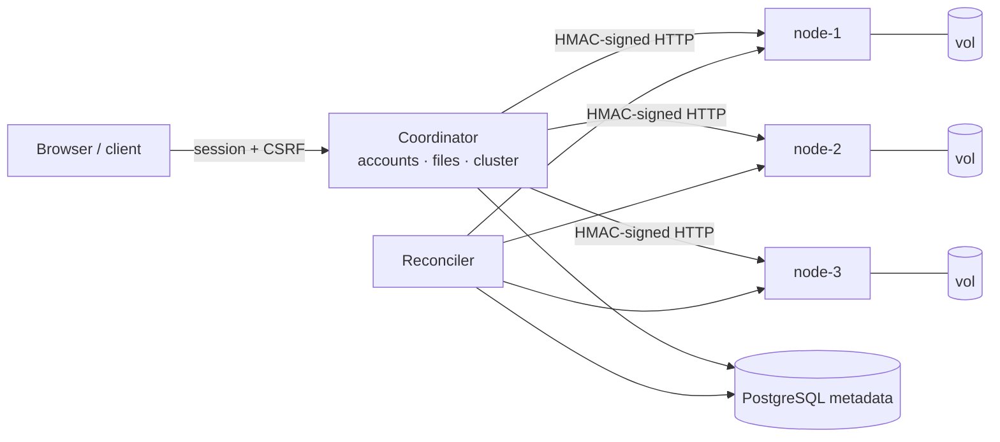

# NodeMesh — replicated object storage with verified reads and self-repair

NodeMesh stores files on several independent storage nodes. A Django
coordinator places **three copies** of every object, confirms an upload only
once a **write quorum** has durably stored and checksum-verified it, serves
downloads only after **end-to-end SHA-256 verification** (falling back to
another replica when one is down or corrupt), and runs a **reconciler** that
detects failed nodes and restores missing or damaged copies.

> **Origin.** This project started as a university examination project on
> distributed systems: four copied Django projects that replicated uploads to
> three nodes. A later audit (kept in [`AUDIT.md`](AUDIT.md), in French) found
> that replicas 2 and 3 received empty files, every download was corrupted,
> nodes were unauthenticated, and nothing timed out. The project was then
> rebuilt from the ground up. The two-tier idea (coordinator + storage nodes)
> was kept; everything else is new, tested, and documented below.

## Features

Every item below is implemented and covered by automated tests.

- **Two independent Django projects.** One coordinator; one storage-node
  codebase that runs as N instances (each with its own id, keys and volume).
- **Durable node writes.** Each write is streamed and SHA-256-checked, fsynced,
  then published with an atomic directory rename. Partial objects are never visible.
- **Quorum replication.** RF = 3 and W = 2 by default. Transfers run in
  parallel with bounded timeouts. Under-replicated files are reported, never
  hidden. Below quorum the upload fails explicitly (503).
- **Verified reads with fallback.** Corrupt or missing replicas are detected,
  recorded and skipped. Clients never receive unverified bytes.
- **Failure detection.** Node health is `healthy` → `unreachable` → `suspect`.
  One timeout is not a verdict.
- **Reconciliation.** It covers:
  - crash recovery for interrupted uploads;
  - garbage collection of failed and deleted files;
  - periodic scrubbing;
  - re-replication;
  - orphan cleanup and adoption of lost acknowledgements.
- **Security.**
  - Users: per-user authorisation (foreign files return 404), session auth with CSRF.
  - Internal traffic: per-node HMAC keys with rotation, replay protection, and
    body-digest binding.
  - Browser: strict CSP, no HTML sinks in the UI, raw-body uploads that are
    never parsed before authentication.
  - Configuration: no secrets in the repository.
- **Operations.**
  - One `make` interface for local development and for the Docker cluster:
    build, explicit migrations, start, status, logs, repair.
  - Docker images (non-root, no published node ports, read-only node root
    filesystem), each built once.
  - Health checks that mean something: database reachable, node volume
    writable, reconciler cycles succeeding.
  - Safety guards: no automatic migration of a shared database, no silent node
    re-registration, no mass deletion by orphan cleanup.
  - JSON logs with bounded rotation.
  - CI: lint, tests on PostgreSQL 17, and a Docker failure smoke test.

## Architecture



Details: [architecture](docs/architecture.md) · [consistency and failure semantics](docs/consistency.md) ·
[API](docs/api.md) · [security](docs/security.md) · [operations](docs/operations.md) · [testing](docs/testing.md)

## Guarantees (RF = 3, W = 2)

| | Guaranteed |
|---|---|
| Upload `201` | ≥ 2 nodes fsynced bytes whose SHA-256 they verified; `under_replicated` says whether all 3 did |
| Upload `503` | The file is not available; partial copies are garbage-collected; the idempotency key is released |
| Download `200` | Size and SHA-256 equal the values recorded at upload |
| One node down | Uploads succeed (2/3, repaired later); all existing files remain readable |
| Retries | The same `Idempotency-Key` never creates a second file |

**Not guaranteed:**
- availability of the coordinator and PostgreSQL (single points of failure);
- independence of nodes that share one host;
- instant repair (it runs each reconciler cycle).

See [consistency.md](docs/consistency.md#what-is-not-guaranteed).

## Components

| Service | Role |
|---|---|
| **Coordinator** | Web UI and API: users, authorisation, metadata, placement, quorum writes, verified reads |
| **Reconciler** | Background loop (same code as the coordinator): health probes, crash recovery, scrubbing, re-replication, garbage collection |
| **Storage node** | One codebase, N instances: stores immutable objects on its own volume; private, HMAC-authenticated API |
| **PostgreSQL** | All metadata (users, files, replicas, node registry); the single source of truth |

## Getting started

`make help` lists every command. Two workflows are supported, each documented
step by step.

**Local development**: Python virtualenv, no Docker, any PostgreSQL
([docs/development.md](docs/development.md)):

```bash
make venv && make dev-env        # then set POSTGRES_PASSWORD in .env
make dev-migrate                 # after `make dev-migrate-plan`
make dev-nodes                   # terminal 1: 3 storage nodes from one codebase
make dev-register && make dev-run   # terminal 2: http://127.0.0.1:8000
```

**Docker cluster**: Linux host, existing PostgreSQL container
([docs/deployment.md](docs/deployment.md)):

```bash
make cluster-env                 # then fill in the PostgreSQL values in .env.cluster
make cluster-config cluster-build
make cluster-migrate-plan cluster-migrate
make cluster-up                  # waits until every service is healthy
```

**Try it without any setup**: an isolated, throwaway stack with its own PostgreSQL:

```bash
make cluster-env cluster-test-up cluster-test-demo cluster-test-down
```

## Documentation

| Document | Contents |
|---|---|
| [development.md](docs/development.md) | Workflow A: install, configure, run, test locally |
| [deployment.md](docs/deployment.md) | Workflow B: Docker deployment, database, volumes, remote access, updates |
| [operations.md](docs/operations.md) | Status, failure recovery, nodes, key rotation, backups, troubleshooting |
| [architecture.md](docs/architecture.md) | Components, data model, write/read paths, failure detection, repair |
| [consistency.md](docs/consistency.md) | Exact guarantees and what is not guaranteed |
| [api.md](docs/api.md) | Public API and internal node protocol |
| [security.md](docs/security.md) | Threat model and controls |
| [testing.md](docs/testing.md) | Test suites and isolation |

## Failure demonstration

`scripts/cluster_demo.py` uploads a file and stops `node-2`. It then downloads
the file again (verified against its SHA-256), uploads a second file during the
outage (accepted at quorum, 2/3), restarts `node-2`, runs a reconciliation
cycle, and checks the second file is back to 3/3.

Output from a run against real node processes:

```
==> upload a 3145735 byte file
    ok: upload accepted (HTTP 201)
    ok: 3/3 replicas stored
==> stop node-2
==> download the first file again
    ok: download succeeded with node-2 down (HTTP 200)
    ok: SHA-256 matches the original
==> upload a second file while node-2 is down
    ok: upload accepted at write quorum (HTTP 201)
    ok: 2/3 replicas, flagged under-replicated
==> restart node-2
==> run one reconciliation cycle
    report: {"files_removed": 0, "nodes_healthy": 3, "replicas_created": 1}
    ok: second file re-replicated to 3/3
    ok: second file downloads intact
```

## Tests

```bash
make test    # 135 tests: protocol, storage engine, node API, coordinator rules, web security,
             # and 22 distributed scenarios against real storage-node processes
```

The tests never touch the development database (see [testing.md](docs/testing.md)).

## Indicative performance

These numbers come from `scripts/benchmark.py` with 8 files per row, and are
**not** capacity claims. The setup was:
- coordinator (gunicorn, 2 workers × 4 threads) and 3 storage nodes on one
  Apple M5 laptop, over loopback;
- metadata in PostgreSQL 17 on a separate Linux server, reached through an SSH
  tunnel (about 4.6 ms per query round trip);
- macOS `fsync`, which does not flush the drive cache.

| Size | Concurrency | Upload MiB/s (3 copies) | Upload p50 / p95 | Verified download MiB/s | Download p50 / p95 |
|---:|---:|---:|---:|---:|---:|
| 0.1 MiB | 1 | 1.0 | 0.10 / 0.11 s | 2.1 | 0.04 / 0.07 s |
| 1 MiB | 4 | 34 | 0.10 / 0.13 s | 72 | 0.04 / 0.06 s |
| 10 MiB | 4 | 190 | 0.21 / 0.22 s | 694 | 0.06 / 0.06 s |
| 50 MiB | 4 | 290 | 0.69 / 0.77 s | 1858 | 0.10 / 0.12 s |

Small transfers are dominated by database round trips. An upload costs 14
queries, including session and authentication. It cost 37 before replica rows
were created in bulk with the file row and transfer outcomes were batched. A
verified download costs 5 queries. With the database on the same host or
network as the coordinator (the Docker deployment), round trips are far cheaper.

Known bottlenecks:
- the coordinator relays every byte, both up and down;
- spool-and-verify adds latency before the first byte and needs temporary disk
  equal to the object size per concurrent download;
- one PostgreSQL instance holds all metadata.

## Limitations and roadmap

- **Coordinator and PostgreSQL are single points of failure.** Node failures
  are tolerated; coordinator failures are not. A replicated metadata store would
  be the next step.
- **No rebalancing.** New nodes receive new and repaired copies only.
  Over-replication after a node returns is tolerated, not trimmed.
- **No chunking.** Objects are replicated whole, so object size is bounded by
  `NODEMESH_MAX_UPLOAD_BYTES` and by node disks.
- **No rate limiting.** There is no login rate limiting, no per-user quotas, and
  no encryption at rest (see [security.md](docs/security.md#known-security-limitations)).
- **Encrypted transport needed across machines.** Node traffic must be put in
  a WireGuard/SSH tunnel or TLS when nodes run on other machines.

## Repository layout

```
coordinator/      Django project A: accounts, files, cluster apps; UI; reconciler
storage-node/     Django project B: one codebase for every storage node
shared/           nodemesh_common: request signing, env parsing, JSON logging
docker/           Dockerfiles and entrypoints
compose.yaml      the cluster; overlays: compose.external-db.yaml, compose.test.yaml
scripts/          env generation, local nodes, DB inventory, demo, benchmark
docs/             development, deployment, operations, architecture, consistency, API, security, testing
AUDIT.md          the original audit of the academic version (historical)
```
