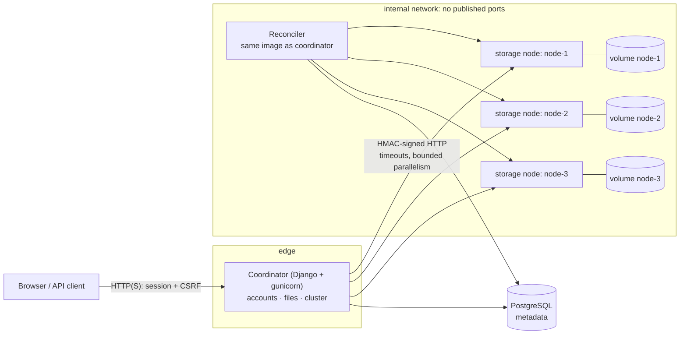
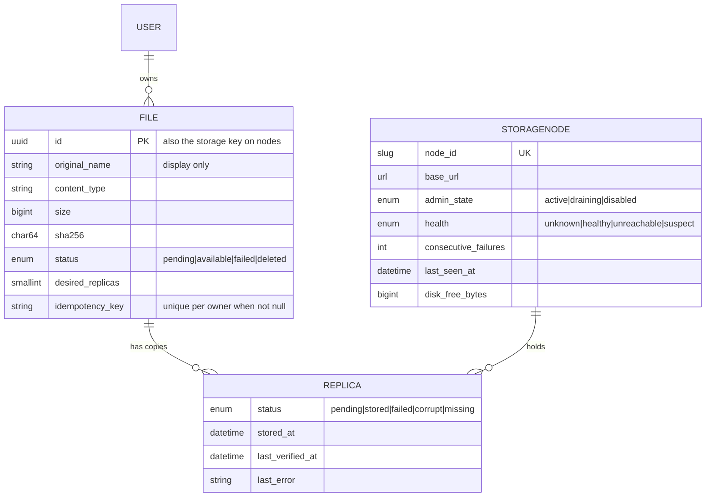
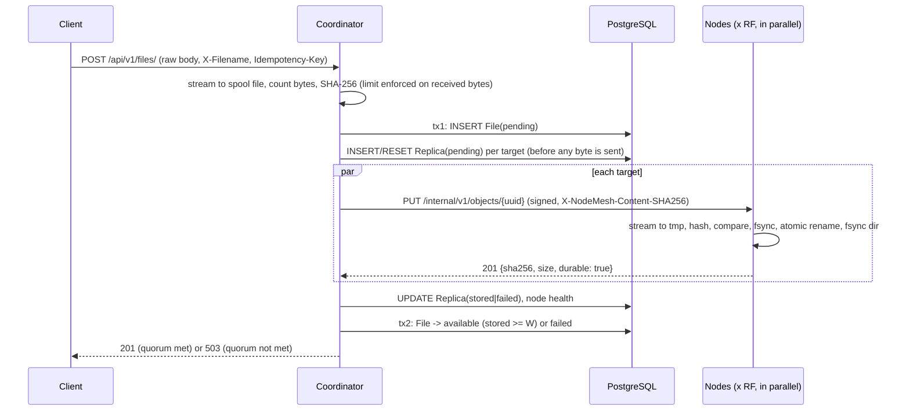

# Architecture

NodeMesh is a replicated object store with a single coordinator. This document
describes the components, the data model, the write and read paths, failure
handling, and the design decisions behind them.

## Components

| Component | Code | Responsibility |
|---|---|---|
| Coordinator | `coordinator/` | Users, authorisation, metadata, placement, quorum writes, verified reads, the UI and the public API |
| `accounts` app | `coordinator/accounts/` | Registration, login, logout (Django sessions) |
| `files` app | `coordinator/files/` | `File`/`Replica` models, upload/download/replication services, reconciler, public API |
| `cluster` app | `coordinator/cluster/` | `StorageNode` registry, node HTTP client, health tracking, placement |
| Reconciler | `manage.py reconcile --loop` | Health probes, crash recovery, garbage collection, scrubbing, re-replication |
| Storage node | `storage-node/` | Durable, digest-verified object storage on a local volume; minimal internal API |
| Shared protocol | `shared/` (`nodemesh_common`) | Request signing (HMAC), env parsing, JSON logging |

The storage node is a single codebase. Each running instance is defined only
by its environment (`NODE_ID`, `NODE_DATA_DIR`, `NODE_HMAC_KEYS`) and its
volume. Adding a node means starting another instance and registering it.
No code is copied.

## Data model (coordinator, PostgreSQL)

Constraints enforced by the database:
- a unique `(owner, idempotency_key)` when the key is not null;
- a unique `(file, node)`;
- `CHECK` constraints on every status column.

The indexes cover these access patterns:
- listing a user's files: `(owner, status, -created_at)`;
- finding stale uploads: `(status, created_at)`;
- per-node replica scans: `(node, status)`;
- scrubbing: `(status, last_verified_at)`.

Objects are **immutable**. "Changing" a file means uploading a new object with a new UUID.

## Write path

- No database transaction is held open while bytes travel to nodes. Each
  replica outcome is a short single-row update.
- A failed target is replaced by the next eligible node (if any) until RF
  copies exist or the candidates run out.
- Node PUTs are idempotent. The same id with the same digest returns 200, so
  retries after a timeout are safe. The same id with a different digest returns 409.
- The upload never goes through Django's multipart parser. The CSRF middleware
  parses multipart bodies *before* views run, which would let an anonymous
  client spool large files to disk. A raw body is never parsed before
  authorisation, and `RejectFileUploads` drops multipart file parts anyway.

## Read path

1. Authorise: only the owner of an `available` file gets a non-404 answer.
2. Order the `stored` replicas by node health (healthy, then unknown, then
   unreachable, then suspect; disabled nodes are skipped).
3. For each replica, stream it into an anonymous temp file while counting bytes
   (aborting past the recorded size) and hashing.
4. Serve the temp file only if both size and SHA-256 match. Otherwise mark the
   replica `corrupt` (wrong bytes) or `missing` (404), record node health, and
   try the next replica.
5. `503 no_replica_available` if none verifies.

This is **spool-and-verify**: the client never receives unverified bytes. The
cost is that the first byte arrives only after the whole object has been
fetched, and the coordinator needs temporary disk equal to the object size per
concurrent download.

## Failure detection

| State | Meaning | Placement | Counts toward replication |
|---|---|---|---|
| `unknown` | never contacted | yes | yes |
| `healthy` | last contact succeeded | yes (preferred) | yes |
| `unreachable` | 1 to N-1 consecutive failures, possibly transient | yes (last resort) | yes |
| `suspect` | at least N consecutive failures (`NODEMESH_SUSPECT_AFTER_FAILURES`, default 3) | no | **no** (re-replication starts) |

Every interaction feeds health: passive signals from uploads and reads, and
active signals from the reconciler's probe of `/internal/v1/status`. A single
timeout never declares a node failed. Updates are single SQL statements with
`F()`/`CASE`, so concurrent workers cannot lose increments. Administrative
state (`active`/`draining`/`disabled`) is independent of observed health.

## Reconciliation

`manage.py reconcile` runs these idempotent steps once. With `--loop` it repeats
them every `--interval` seconds; Compose runs it as the `reconciler` service.
A PostgreSQL advisory lock prevents two reconcilers from overlapping. Nodes
that fail the probe in a cycle are not contacted by the later steps of that cycle.

| Step | Resolves |
|---|---|
| `probe_nodes` | health, free space, node-identity check |
| `resolve_stale_pending` | coordinator crash between "PUTs sent" and "outcome recorded": asks nodes (HEAD) and finalises by quorum |
| `purge` | deletes copies of `failed`/`deleted` files; removes deleted rows once no copy remains |
| `scrub` | node-side re-hash of `stored` replicas never verified or not verified for `NODEMESH_VERIFY_INTERVAL_SECONDS` |
| `repair_bad_replicas` | deletes `corrupt` copies; forgets `missing` ones |
| `re_replicate` | files whose countable replicas are below the desired count: verified fetch from a good replica, then PUT to new targets |
| `collect_orphans` | node objects unknown to metadata are deleted after a grace period; valid copies the coordinator lost track of (lost acknowledgements) are adopted |

Nodes clean their own `tmp/` and `trash/` on startup (`cleanup_temp`), so
interrupted writes never become visible objects.

## Design decisions and trade-offs

| Decision | Why | Cost / alternative |
|---|---|---|
| Single coordinator + PostgreSQL | Strongly consistent metadata with ordinary transactions; easy to reason about | Coordinator and database are single points of failure (see limitations) |
| Immutable objects keyed by server UUID | No update conflicts between replicas; any replica with the right hash is correct | Updates are new objects; no deduplication |
| UUID keys, not content hashes | No cross-user existence side channel, simple deletes | Identical files are stored twice |
| Full-object replication (RF=3, W=2) | Survives one node loss for reads and writes with three nodes | Storage overhead 3x; capacity is not partitioned beyond placement |
| Spool-and-verify reads | Never serve corrupt bytes; real fallback | Latency and temporary disk on the coordinator |
| Filesystem + JSON sidecar on nodes (no DB) | Coordinator is the source of truth; nothing to migrate or corrupt on nodes | Listing objects walks directories (fine at this scale) |
| Atomic directory rename for publication | Data and metadata appear together or not at all; concurrent writers of a key cannot both win | Relies on POSIX `rename` semantics (local filesystems) |
| HMAC per node, key ids, nonces | Standard library only, no secret on the wire, replay-resistant, rotatable | Not confidentiality: use a private network or TLS across machines |
| Reconciler as a loop process (no Celery/Redis) | Operationally simple; idempotent steps | Repair latency is the loop interval; one worker |
| Raw-body upload API | Bounded, streamable, and never parsed before authorisation | Browser uses XHR rather than a plain HTML form |
